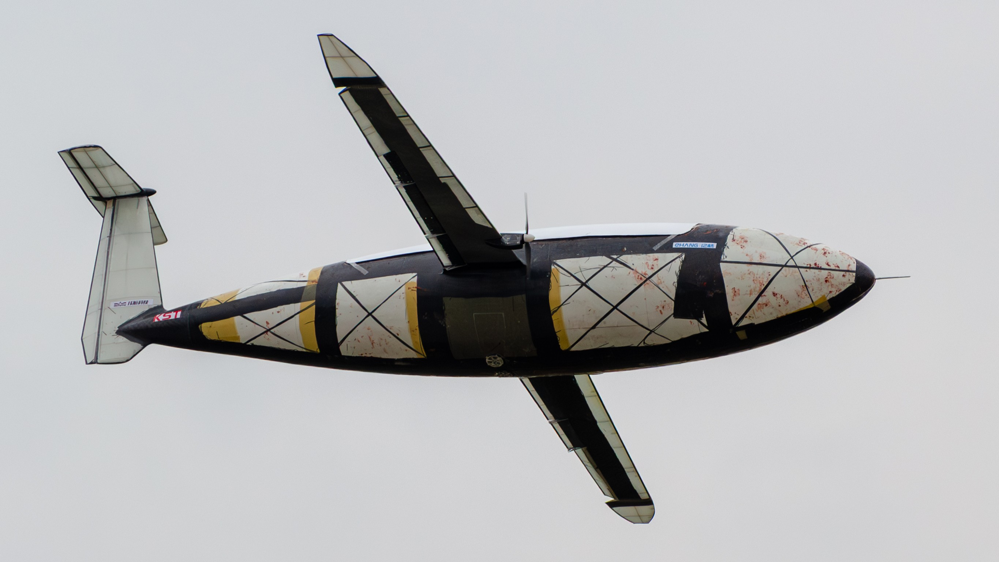

# Kirov Reporting!


Hi！

这里是 THU AIR 限时载运机组，我们将 2026 CUADC 的飞机仿真模型完全开源，供大家交流学习和体验飞行。如果遇到任何问题，请提交 Issue。

## 启动仿真

1. 准备一个 joystick 输入手柄（支持的遥控器、游戏手柄均可）。
2. 打开 MATLAB，在当前文件夹下启动 `Kirov_sim.prj`。
3. 打开 `simulation/Kirov_physics.slx`，注意不要切换工作目录，运行仿真。
4. （可选）运行 `runfg_train.bat`，启动 FlightGear 界面。
5. （可选）运行 QGC，连接 UDP 14550 端口，获得实际航线。下载机上任务可显示参考旗杆位置。
6. （可选）`Control_Input` 和 `SendState` 模块切换到 `Ardupilot` 之后，可以启动Ardupilot联合仿真。
7. （推荐）任务管理器->详细信息->右键 `MATLAB.exe`，优先级设置为高。

## 遥控器配置

1. 推荐的配置顺序：
   1. Aileron
   2. Elevator
   3. Throttle
   4. Rudder
   5. Gear
   6. Flap
   7. Brake
   8. Spoiler
2. 默认范围都是 -1~1，-1 对应干净构型。
3. 遥控器映射到 joystick 的顺序可以在仿真中 `RC` 模块修改。
4. 舵面组合、混控等可以在 `Actuator` 模块配置。
5. 建议方向舵、升降舵比例 80%，其他均 100%，最好加点 exp。

## FlightGear 配置

1. 下载好 FlightGear 之后，如果是新版本，打开后会自动进行补充文件的下载，将下载的补充文件夹重命名为data，使得文件夹结构呈现：
```
FlightGear 2024.1/
├── bin/
├── data/
│   └── Aircraft/
│       └── Kirov/
└── Download/
```
2. 将 `flightgear` 文件夹下的 `Aircraft` 文件夹复制合并到安装目录下的 `data/Aircraft` 文件夹中。将 `custom_tower.xml` 复制到安装根目录下。最终呈现为：
```
FlightGear 2024.1/
├── bin/
├── data/
│   └── Aircraft/
│       └── Kirov/
├── Download/
└── custom_tower.xml
```
3. 可根据电脑性能适当调整 FlightGear 的渲染效果。
4. 在英文输入模式下，按 `v` 切换视角到 Tower View，按 `x/X` 可以放大或缩小视角。

## Ardupilot 配置
```
cd ~/ardupilot
./Tools/autotest/sim_vehicle.py -v ArduPlane -f plane --model JSON:127.0.0.1 --no-wsl2-network -S 1 --custom-location="25.494443,-80.557063,1.96,0"
```
可选 `-w` 清除配置。
